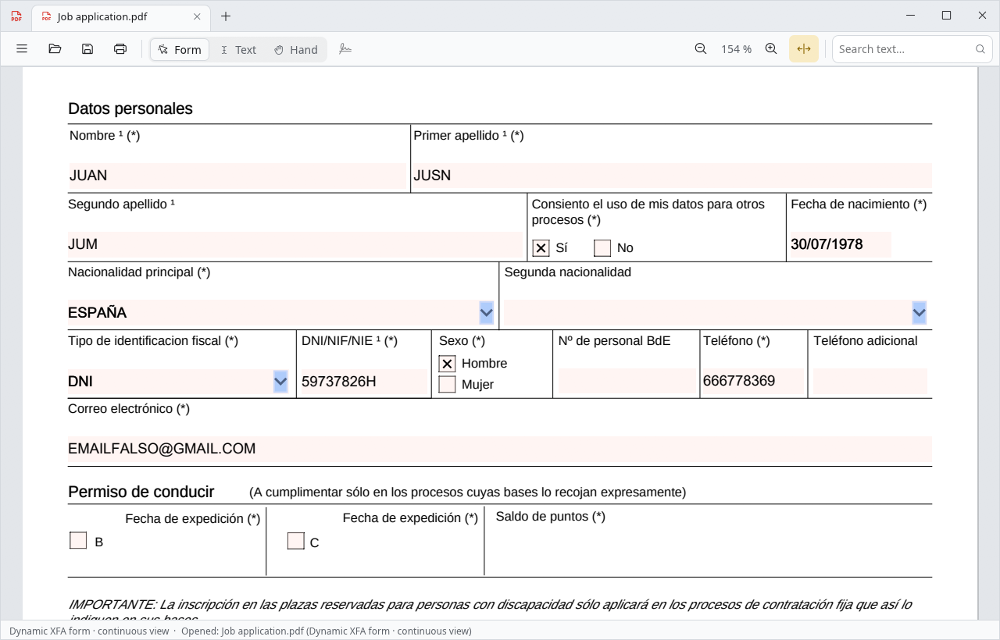
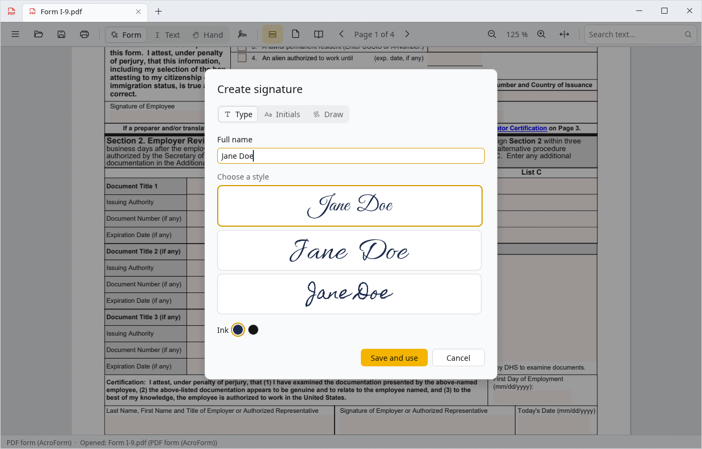
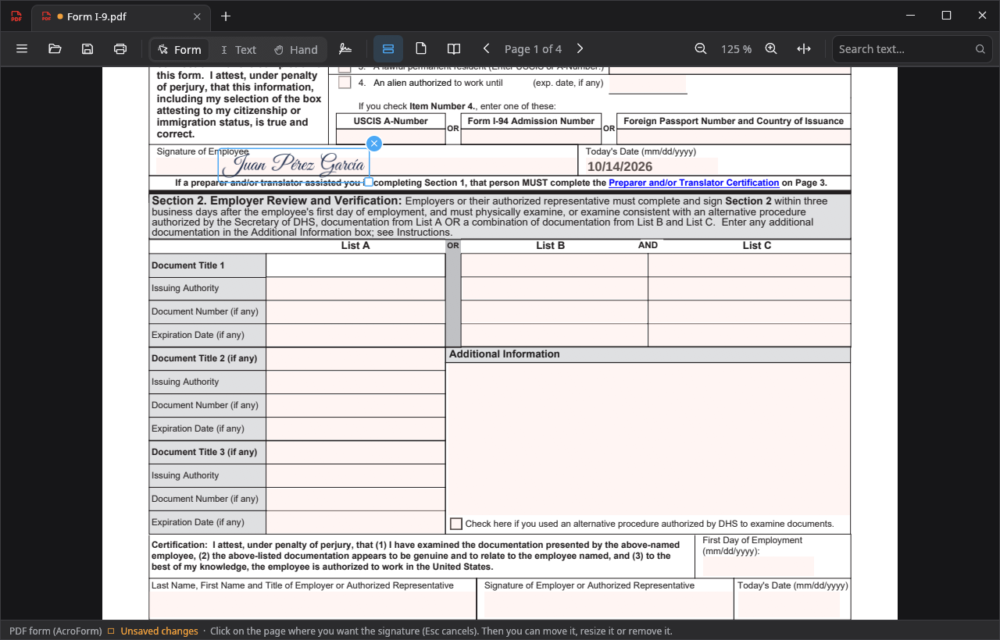
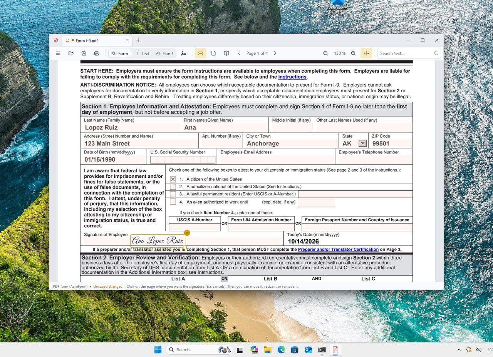
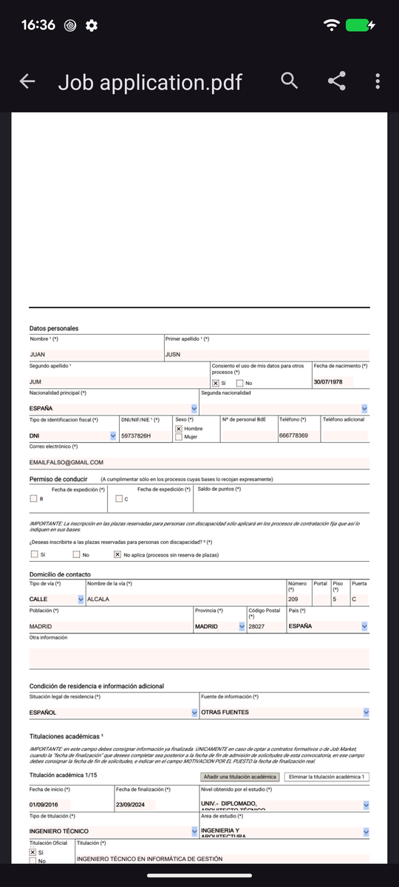
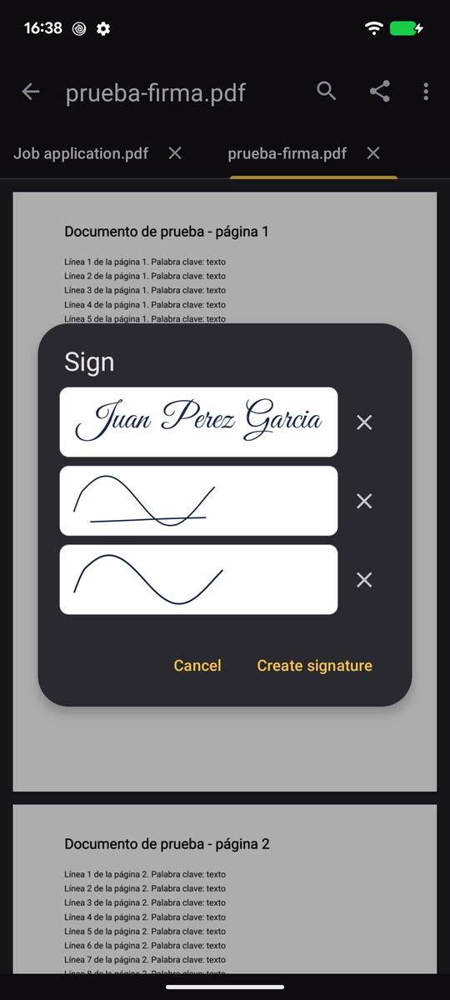
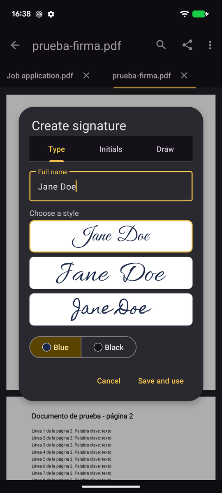

# Form PDF Reader

**A lightweight PDF reader that reads, fills in, signs and saves dynamic XFA
forms on Linux, Windows and Android, without Adobe Reader.**

<p align="center">
  
</p>

Many official forms are dynamic XFA forms (Adobe LiveCycle). Other PDF
viewers only show a "Please wait… / Adobe Reader 8 or higher is required"
page, or render the form without running its scripts. Form PDF Reader runs
those forms properly: dropdowns get their options, sections appear and
disappear, validations work, and the result is saved in a way Adobe Reader
accepts.

It is also an ordinary PDF reader with tabs, text selection and several page
layouts, and it lets you sign documents as in DocuSign. It is lightweight:
a download of about 20 MB with everything it needs, it opens in a moment,
and it draws its own interface without a graphics card if there is none
(virtual machines, remote desktops). It is written in Rust with
[egui](https://github.com/emilk/egui), on top of Chromium's **PDFium**
engine built with V8 and XFA.

It was created to fill in the Banco de España job application form, which no
free Linux viewer could handle.

The interface is available in English, Spanish, French, Italian, Portuguese
and German. On the desktop it follows the system language (`LANGUAGE`,
`LC_ALL`, `LC_MESSAGES`, `LANG`), and **☰ > Settings** lets you choose
another one, which applies at once and is remembered in
`~/.config/form-pdf-reader/settings.conf` (on Windows,
`%APPDATA%\form-pdf-reader\settings.conf`). `FORM_PDF_READER_LANG=fr` (or
`en`, `es`, `it`, `pt`, `de`) forces one. The Android app follows the
device's language, or the app language chosen in the system settings
(Android 13+). Any other language uses English.

Desktop translations live in `crates/core/locales/<code>.txt` (adding one
means adding a file there and registering it in `crates/core/src/i18n.rs`);
the Android ones in `android/app/src/main/res/values-<code>/strings.xml`.
Texts that belong to a form itself (its labels, messages and validations)
stay in the form's own language.

## Screenshots

| Light theme, signing a form | Dark theme, a signature placed |
|---|---|
|  |  |

**Windows 11, filling in and signing a form**



**Android**

<p>
  
  
  
</p>

The forms shown are the Banco de España application form filled in with
made-up data and the public US Form I-9.

## Features

- **Reading:** normal PDFs with zoom, text search, tabs, and continuous,
  single page or two-column layouts.
- **Desktop window:** its own title bar with the document tabs, as in
  modern Windows apps (on Windows 11 the maximize button shows the snap
  layouts); light or dark theme following the system, or chosen in
  **☰ > Settings**. The toolbar compacts itself when the window is narrow.
- **Tools:**
  - *Form* (default): fill in fields and press form buttons.
  - *Text*: drag to select text and copy it with Ctrl+C.
  - *Hand*: drag to scroll.
- **Forms:** AcroForm and XFA, static and dynamic, also when the PDF is
  protected with an owner password. That covers text, multi-line paragraphs,
  dates, dropdowns, checkboxes, add/remove row buttons, and the form's own
  JavaScript, including validations and messages. In a field, part of the
  text can be selected (dragging the mouse, double click, or Shift + arrows)
  and deleted or replaced, as in Adobe Reader.
- **Attachments:** the form's own attachment section works (add, view,
  delete), with its size and type limits. Files are embedded in the PDF the
  same way Acrobat does it. "View" opens PDF attachments in a new tab.
  "Archivo > Adjuntos del PDF…" lists the embedded files of any PDF.
- **Protected PDFs:** a PDF that needs a password to open asks for it, and
  stays protected with the same password when saved.
- **Signatures, as in DocuSign:** your name or initials in handwriting
  (three styles) or a signature drawn with the mouse, a pen tablet, a
  finger or a stylus. They are kept on each device to use again (the Sign
  button), and go where you click or tap on the page; until you save they
  can be moved, resized or removed. Saving writes them into the PDF as
  vector drawings, without touching what was there. Not on dynamic XFA
  forms, which Adobe Reader shows without annotations.
- **Digital signatures with a certificate:** Sign > "Sign with
  certificate…" signs the document as it is (form data included) with a
  PAdES signature, the European standard that Adobe Reader recognises. The
  certificate can be:
  - a certificate file (`.p12`, `.pfx`), such as the one the FNMT or a
    browser exports, on every platform;
  - an installed one: on Windows, the user's certificate store, which also
    has the national ID card (DNIe) and other smart cards with a reader; on
    Linux, Chrome's and Firefox's certificates (NSS) and smart cards and the
    DNIe through PKCS#11 (OpenSC or the official DNIe module); on Android,
    the certificates installed on the device and the DNIe over NFC (with
    its CAN and PIN, holding it against the phone).

  Smart cards and the DNIe (with a reader or over NFC) and the certificates
  installed on Android are marked **beta**: they could not be tested with
  every card and device. Certificate files, the browsers' certificates and
  the Windows store's own certificates are tested.

  The private key never leaves where it is (the system or the card signs);
  the key of a file is only in memory while signing. The signature can be
  visible (a box with the name and the date, and your handwritten signature
  if you want, where you click or in a signature field of the document) or
  invisible, with an optional reason and location and, on the desktop, an
  optional timestamp from a timestamp server (PAdES B-T). It is saved as a
  signed copy. In dynamic XFA forms the signature is invisible and Adobe
  Reader does not show it: it only recognises the form's own XFA signature
  fields.
- **Seeing digital signatures:** the ones a PDF already has are listed (☰ >
  Digital signatures…), with the signer, the certificate's issuer and
  validity, the date and reason, and whether the signed content is
  unchanged, had changes added afterwards or was altered. Whether the
  certificate comes from a trusted authority is not checked yet.
- **Saving:** Ctrl+S and Save As, with a warning about unsaved changes.
  Saving keeps the original file intact (see below).
- **Printing:** a print dialog with the installed printers, pages (all,
  current or a range such as `1-3, 5`), copies, color or black and white,
  two-sided printing and a preview. On Linux it prints through CUPS, on
  Windows straight to the printer (with its own preferences dialog), and on
  Android with the system's print screen (printers and "Save as PDF").
  What is printed is the document as it is shown, with the form data and
  the signatures; a dynamic XFA form is cut into A4 sheets. "Open as PDF"
  in the dialog still opens a flat copy in the system viewer.
- **Export:** a "flat" (image) PDF, with A4 sheets for dynamic XFA forms.
- **Annotations:** highlight, underline or strike out text, notes (an icon
  with a comment), text written anywhere on the page and freehand drawing,
  in six colours (the toolbar's highlighter button on the desktop, ⋮ >
  Annotate on Android). With *Select*, an annotation can be deleted or its
  text changed. They are saved as standard PDF annotations, which Adobe
  Reader and other viewers show. Not on XFA forms.
- **Organise pages** (☰ > Organise pages… on the desktop, ⋮ on Android):
  thumbnails of every page to select several (Ctrl/Shift on the desktop),
  drag to put them in another order, rotate, delete or extract to a new PDF;
  and insert the pages of another PDF (or, on Android, of a scan). Not on
  XFA forms nor on documents locked by a signature.
- **Scanning (Android):** "Scan document" on the start screen takes photos
  with the device's camera app (or chooses them from the gallery). For each
  page the app finds the sheet (its corners can be moved), straightens the
  perspective, turns it upright with a small model (PaddleOCR's document
  orientation model) and applies a filter: colour, grey, or black and white
  like a photocopy (also with shadows). The scan opens as a new document;
  "Insert scanned pages…" adds pages to an open one. Everything runs on the
  device with the app's own code, without Google services.
- **Text recognition (OCR, Android):** scans get an invisible text layer
  with the text read from the image (PaddleOCR's text detection and Latin
  recognition models, for Spanish, English, French, Italian, Portuguese,
  German and other Latin-script languages), so they can be searched and
  their text selected and copied, here and in any viewer. ⋮ > Recognise
  text (OCR) does the same for any open PDF made of images.

## How dynamic XFA forms are handled

PDFium can run XFA, but it has bugs with complex forms. The application
applies these fixes **only to the in-memory copy** that PDFium sees. The file
on disk is never altered.

1. **Continuous view.** PDFium's XFA pagination loses and reorders sections,
   so the form is shown as a single long page, like a web form.
2. **Script references.** Adobe resolves `xfa.resolveNode("Name")` with a
   deep search and PDFium does not; without this fix dropdowns stay empty.
3. **Widget relayout.** After sections appear or rows are added, PDFium
   leaves controls at their old position. The cause is in
   `CXFA_FFNotify::OnLayoutItemAdded`, which compares a reference with
   itself. An invisible button injected into the template forces a relayout.
4. **Attachments.** The form uses Acrobat-only functions (`importDataObject`,
   `dataObjects`, `getDataObject`, `removeDataObject`, `exportDataObject`).
   They are replaced by an object that talks to the application through
   `app.response()`.
5. **Read-only buttons.** Adobe runs clicks on buttons with
   `access="readOnly"` (View, Delete) and PDFium does not. Their click event
   is run with `execEvent("click")`.
6. **Removing rows.** PDFium does not relayout after `removeInstance()`. The
   row is hidden first and a relayout is forced.
7. **Translated labels.** The form framework calls `exData.loadXML()`, which
   PDFium lacks, and the exception aborted whole scripts. It is replaced by a
   working version.
8. **Cascading dropdowns.** PDFium fires `change` again with empty text when
   a script assigns `rawValue`, and also when a script fills a list. Only
   changes on the focused dropdown are processed, and dependent lists are
   filled when the PDF is opened, as Adobe does.
9. **Dates.** Stored as DD/MM/YYYY, as Adobe does with these forms; the
   form's validation requires it. The cell "comb", which PDFium draws with
   white stripes, is removed.
10. **Formatting and validation on exit.** Forms do this with
    `listen="refAndDescendents"` events, which PDFium ignores. They are
    copied to every field: text becomes uppercase and calendar dates become
    DD/MM/YYYY, as in Adobe.
11. **Script objects.** PDFium mixes up the variables of script objects with
    the same name. Each one is wrapped in a function to isolate them.
12. **User changes only.** PDFium fires `change` when a script assigns a
    field, for instance on open, and several form scripts erased data on that
    spurious event. Change scripts now run only when the field has focus.
13. **Form state.** Adobe stores which fields are open, which sections are
    visible and the value of unbound checkboxes, and PDFium does not restore
    it. The application restores it from Adobe's `form` packet or from its
    own copy, written when saving.
14. **subformSet.** PDFium makes everything inside a `subformSet`
    non-interactive. It is replaced by an equivalent subform.
15. **Re-running initialize.** After a user change on a dropdown, Adobe runs
    its `initialize` script again, and some forms depend on it. The
    application does the same.

The interface also works around some PDFium behaviour:

- Clicking a field's label moves focus to the field, as in Adobe. Otherwise
  PDFium leaves focus half-set and typed text ends up in another field.
- Clicking a checkbox's text toggles it.
- Closing a dropdown by clicking outside used to leave its list drawn without
  a background; the application closes it with Escape first.
- A click on the date picker button, which is drawn partly outside the
  field, is redirected to it.

**When saving**, the PDF produced by PDFium is not used. An incremental update
is appended to the original file. It replaces only the data packet
(`datasets`), the embedded attachments and the saved form state. The
original template and Adobe's Reader Extensions signature stay intact, just
as when Adobe Reader saves the form.

## Known limitations

- Submitting the form by e-mail or web does not work.
- Non-embedded corporate fonts are replaced by Liberation Sans (Arial on
  Windows), so some text is slightly wider.
- The date picker is in English (PDFium's choice) and opens on the current
  month. Dates can also be typed.
- PDFium wraps the displayed text of some dropdowns onto two lines. The stored
  value is correct.
- The *Text* tool does not select text on dynamic XFA forms, because PDFium
  renders them without a text layer. The text of each field can still be
  selected while editing it.
- Dynamic XFA forms are always shown in continuous view.
- If a PDF saved by this application is opened in Adobe Reader, Adobe uses
  its own saved form state from the last time it saved the file. The data is
  always correct.

## Usage

```bash
form-pdf-reader file.pdf
```

Shortcuts:

- **Files:** Ctrl+O open, Ctrl+S save, Ctrl+Shift+S save as, Ctrl+P print,
  Ctrl+W close the tab.
- **View:** Ctrl+F search, Ctrl+wheel or Ctrl+/− zoom, Ctrl+0 actual size,
  Ctrl+Tab next tab.

Command-line tools (no window):

```bash
form-pdf-reader --info file.pdf
```

`--info` prints the document type and the XFA fixes applied.

```bash
form-pdf-reader --data file.pdf
```

`--data` prints the form data (XFA `datasets`).

```bash
form-pdf-reader --export-flat input.pdf output.pdf 150
```

`--export-flat` exports a flat image PDF at the given DPI. The older Spanish
names `--datos` and `--exportar-plano` still work.

## Installing a release

Each [GitHub release](../../releases) has ready-made packages for x86_64:

| Distribution | File | Install |
|---|---|---|
| Debian 12+, Ubuntu 22.04+ | `form-pdf-reader_*_amd64.deb` | `sudo apt install ./form-pdf-reader_*_amd64.deb` |
| Fedora | `form-pdf-reader-*.x86_64.rpm` | `sudo dnf install ./form-pdf-reader-*.x86_64.rpm` |
| Arch Linux, CachyOS | `form-pdf-reader-*-x86_64.pkg.tar.zst` | `sudo pacman -U form-pdf-reader-*-x86_64.pkg.tar.zst` |
| Any distribution | `form-pdf-reader-*-x86_64.tar.gz` | extract it and run `./instalar.sh` |
| Windows 10/11 (x64) | `form-pdf-reader-*-windows-x64-setup.exe` | run it; it installs for your user, without administrator rights |
| Windows 10/11 (x64), portable | `form-pdf-reader-*-windows-x64-portable.zip` | extract it anywhere and run `form-pdf-reader.exe` |
| Android 8+ (arm64) | `form-pdf-reader-*-android-arm64.apk` | open it on the phone and allow installing it |

The binary is built on Ubuntu 22.04 (glibc 2.35), so it also runs on newer
distributions.

On Windows the installer adds Form PDF Reader to the Start menu and to
"Open with" for PDF files, without changing the default PDF app. The files
are not signed with a code-signing certificate, so Windows SmartScreen may
warn the first time: choose "More info" and "Run anyway".

Without a graphics card (virtual machines, remote desktops), Windows only
offers Direct3D in software, which is very slow for a window this size. The
app detects it and draws the interface with the CPU straight to the window
instead. `FORM_PDF_READER_SOFTWARE=1` forces this mode on any system.

On Arch Linux and CachyOS it can also come from the AUR: `form-pdf-reader-bin`
(the release build) or `form-pdf-reader` (built from source), for example with
`yay -S form-pdf-reader-bin`. Their `PKGBUILD`s are in `packaging/aur/`.

## Building and installing

You need stable Rust, `curl` and the usual desktop libraries: Wayland or X11,
Mesa and fontconfig. `zenity` is used for some form dialogs.

PDFium with V8/XFA is not stored in the repository. This script downloads it
into `vendor/pdfium`, from
[bblanchon/pdfium-binaries](https://github.com/bblanchon/pdfium-binaries),
version chromium/8086, and checks its SHA-256:

```bash
scripts/descargar-pdfium.sh
```

Then build:

```bash
cargo build --release
```

To install it for your user in `~/.local`:

```bash
scripts/instalar-local.sh
```

Other ways to install it:

- `cd packaging && makepkg -si` builds and installs an Arch/CachyOS package,
  downloading PDFium if needed.
  Use `makepkg -si -d` if `cargo` comes from rustup rather than pacman. The
  package replaces the old `pdf-reader-editor` and `simple-pdf-reader`
  packages.
- `scripts/empaquetar.sh` creates a self-contained tar.gz in `dist/`.
- `scripts/appimage.sh` creates an AppImage if `appimagetool` is installed.

On Windows (Rust with the MSVC toolchain, Git Bash for the scripts):
`PDFIUM_PLATFORM=win-x64 scripts/descargar-pdfium.sh`, then
`cargo build --release`; `pdfium.dll` (in `vendor/pdfium/bin`) has to be
next to `form-pdf-reader.exe`. The installer is built with Inno Setup from
`packaging/windows/form-pdf-reader.iss`; the `Windows` workflow does all of
it.

## Android app

`android/` contains a native Kotlin app that uses the same Rust core. The
bridge between Kotlin and Rust is generated with
[UniFFI](https://mozilla.github.io/uniffi-rs/) from `crates/ffi`. The app can:

- show a start screen with the recently opened documents;
- open PDFs from the system file picker or from other apps;
- scroll, and zoom with two fingers;
- fill in forms, including dynamic XFA, by tapping fields and typing on the
  on-screen keyboard; in the field being edited, a long press (then moving
  the finger), a double tap or dragging with a mouse selects part of its
  text, to cut, copy, paste or delete it;
- keep unsaved changes if Android closes the app in the background (or it
  is closed): they are offered again when it is opened;
- keep several documents open as tabs (PDF attachments open in a new tab);
- show pages continuously, one at a time or two side by side, with zoom and
  page controls in the toolbar on tablets;
- select text with a long press (and the handles) or by dragging with a
  mouse, and copy it;
- search the document's text (Ctrl+F), with every result highlighted;
- use a hardware keyboard and mouse: Ctrl+S, Ctrl+O, Ctrl+F, Ctrl+W, Ctrl+Tab,
  Ctrl+plus/minus, Page Up/Down, the wheel to scroll and Ctrl+wheel to zoom;
- save, save as, view attachments and copy the text;
- share the document (with the data filled in) to WhatsApp, Telegram, e-mail
  or any other app, from the viewer or from the recent documents;
- follow the device's light or dark theme (or a fixed one, in Settings);
- annotate, organise the pages and scan documents (see Features);
- on phones, go back to the first page with a button that appears once past
  it, and tap the page number shown while scrolling to go to another page.

The only permission the app asks for is NFC, to read the DNIe when signing
with it (scanning uses the camera app and needs no camera permission): documents come from the system file picker or from other apps, and
the app keeps access only to the ones the user opens.

PDFium and its V8 engine only work from the thread that initialised them, so
the app makes every call to the core from one dedicated thread
(`PdfEngine.kt`). The form's dialogs block that thread, not the interface,
while the user answers.

To build it you need the Android SDK (platform 36) and NDK, JDK 17,
`cargo-ndk` and the Rust target `aarch64-linux-android`. Gradle comes with
the wrapper (`android/gradlew`).

```bash
scripts/android/compilar.sh bundle
```

It runs `scripts/android/build-rust.sh`, which downloads PDFium for Android
arm64 (checking its SHA-256), generates the Kotlin bindings, cross-compiles
the bridge and writes the licences shown in the app; then it builds the APK
and the App Bundle (the format Google Play takes) into `dist/`. It looks for
the SDK in `~/Android/Sdk` and Java 17 in `/usr/lib/jvm/java-17-openjdk`
(`ANDROID_HOME`, `ANDROID_NDK_HOME` and `JAVA_HOME` change them).

Release builds are shrunk and obfuscated with R8; the rules that keep JNA
working are in `android/app/proguard-rules.pro`.

The `Android` workflow does the same on GitHub and attaches the APK and the
App Bundle to each release.

### Signing

Releases are signed with the Google Play upload key, kept as repository
secrets. Create it once, and keep a backup of `~/.config/form-pdf-reader`:

```bash
scripts/android/crear-clave-de-subida.sh
```

The script creates the key with openssl and saves it with `gh secret set`
(`ANDROID_KEYSTORE_BASE64`, `ANDROID_KEYSTORE_PASSWORD`, `ANDROID_KEY_ALIAS`).
Gradle signs with it when `ANDROID_KEYSTORE` points to the key file; without
it, local builds and pull requests from forks use the debug key. Tags fail
without the upload key, so every published APK has the same signature and
updates install over the previous version.

## Tests

```bash
cargo test
```

The integration test always covers a normal PDF and an AcroForm.

The dynamic XFA part needs the blank Banco de España application form. Place
it at `diagnostico/TINTERNET_original.pdf`; it is not in the repository. That
part fills in fields, uses dropdowns and the date picker, shows sections,
works through the attachment section, saves, checks that the original stays
intact as a prefix, exports to A4 and reopens.

If a real filled-in form exists at `diagnostico/formulario_real.pdf`, the
test also checks that opening it changes no data and that the form's
"Validar" button accepts it. Missing files make those parts skip.

`PDFRE_SCRIPT_DEBUG=1`, together with `RUST_LOG=form_pdf_reader=debug`,
logs the exceptions raised by each form event.

`crates/core/examples/probe.rs` drives a form without a window (clicks, typing,
JavaScript evaluation, screenshots of a region):

```bash
cargo run --release -p form-pdf-reader-core --example probe -- file.pdf "click:561,1560;shot:1500,200,/tmp/a.png;datos"
```

A UI driver can run the real interface unattended. `PDFRE_AUTOTEST_FILE`
sets the file the file picker returns:

```bash
PDFRE_AUTOTEST="wait:30;click:300,500;type:Hello;key:Tab;shot:/tmp/a.png;quit" form-pdf-reader f.pdf
```

## Layout

The repository is a Cargo workspace. The core library is independent of the
user interface: the desktop app and the Android app both use it.

```
crates/core/      form-pdf-reader-core: the library (imported as form_pdf_reader)
  src/pdfium/       PDFium layer: bindings (bindgen), callbacks, document, fonts,
                    handwritten signatures on the page, digital signatures
  src/sign/         saved handwritten signatures and their vector shapes
  src/pades/        digital signature (PAdES): CMS, PKCS#12, timestamps
  assets/signature-fonts/  handwriting fonts (OFL and Apache 2.0)
  src/xfa/          XFA compatibility fixes, incremental PDF editing, form state
  src/i18n.rs       translations (catalogs in locales/)
  tests/            integration test and sample PDFs
  examples/         diagnostic tools (probe, packet dump, firmar)
crates/ffi/       form-pdf-reader-ffi: UniFFI bridge used by the Android app
crates/desktop/   form-pdf-reader: the desktop application (egui)
  src/viewer.rs     view: tiles, mouse and keyboard to PDFium, tools, layouts
  src/app.rs        application: tabs, menus, dialogs, saving, printing
  src/chrome.rs     title bar: tabs, window buttons, moving and resizing
  src/theme.rs      fonts, icons and light/dark colours
  src/snap.rs       Windows: system frame and snap layouts
  src/signatures.rs saved signatures menu and "Create signature" dialog
  src/print.rs      print dialog and job; print/cups.rs (Linux), print/win.rs
  src/digital_sign.rs  "Sign with certificate" dialog
  src/certs.rs      certificates: certs/pkcs11.rs (Linux), certs/winstore.rs
  src/soft.rs       window drawn with the CPU when there is no graphics card
  src/autotest.rs   UI test driver
crates/egui_software_backend/   CPU renderer for egui (a copy of the crate
                    of the same name, adapted to this egui version)
android/          Android app (Kotlin) on top of the Rust core
assets/           icons, .desktop file and the screenshots of this README
packaging/ scripts/   packages, PDFium download, install scripts
```

## Licences

Form PDF Reader is distributed under the [MIT License](LICENSE).

It includes third-party software under its own licences: PDFium and its
components (BSD-3-Clause, Apache-2.0 and others), the Rust crates it is built
from (mostly MIT or Apache-2.0; uniffi is MPL-2.0) and, in the Android app,
AndroidX, Material Components, the Kotlin standard library and JNA
(Apache-2.0), Bouncy Castle (MIT) and jmulticard, the official library for
the DNIe over NFC (GPL-2.0 / EUPL-1.1). Because of jmulticard, the Android
app as a whole (the APK) is distributed under the EUPL 1.1, used for
jmulticard; the source code in this repository keeps its MIT licence.
`scripts/third_party_notices.py` writes the notices from the dependency
tree:

- Linux packages: `/usr/share/licenses/form-pdf-reader/` (`LICENSE` and
  `THIRD-PARTY-NOTICES.txt`); in the `.tar.gz`, next to the program.
- Android app: Settings > Open source licences.
